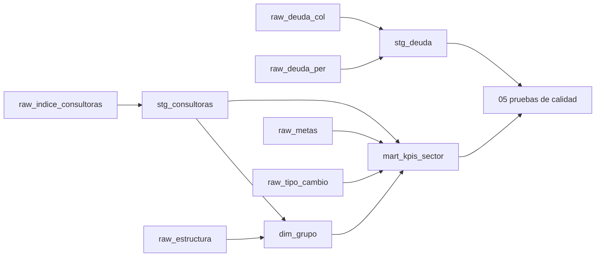

# SQL Analytics · Venta directa multipaís

> 🇪🇸 Pipeline SQL (staging → dimensión → mart → pruebas) sobre datos sintéticos de una empresa ficticia de venta directa que opera en Colombia, Perú y Ecuador.
> 🇬🇧 SQL pipeline (staging → dimension → mart → tests) on synthetic data from a fictional direct-sales company operating in Colombia, Peru and Ecuador.

**Todos los datos son ficticios y se generan con un script; no hay información de ninguna empresa real.**
**All data is synthetic and script-generated; no real company data is included.**

## Qué demuestra / What it shows

| Archivo | Problema de negocio | Técnica SQL |
|---|---|---|
| `01_stg_consultoras_dedup.sql` | La fuente trae filas reprocesadas (duplicados) | `ROW_NUMBER()` + `QUALIFY`, `NULLS LAST` |
| `02_stg_deuda_multipais.sql` | Dos países con esquemas y tipos de llave distintos | `UNION ALL`, homologación de columnas, `CAST` |
| `03_dim_grupo_lider_fallback.sql` | El nombre del líder falta en la fuente principal | `COALESCE` entre fuentes, extracción desde texto libre |
| `04_mart_kpis_sector_ciclo.sql` | KPIs por sector y ciclo: real vs. meta, variación, moneda común | CTEs, `LAG()`, `NULLIF`, conversión de moneda, filtro dinámico de últimos 3 ciclos |
| `05_pruebas_calidad.sql` | ¿Se puede confiar en el resultado? | Pruebas de unicidad, grano, nulos e integridad referencial |

Decisiones de modelado que vale la pena leer en el código:

- **El grano se declara y se prueba.** Cada vista dice a qué nivel vive (consultora+ciclo, grupo, sector+ciclo) y `05` verifica que no se rompa.
- **La estructura comercial sale de la fuente oficial**, no del histórico transaccional, que puede traer reasignaciones erróneas.
- **Las monedas no se mezclan.** Las sumas se hacen en moneda local dentro de cada país y solo después se convierten a USD con la tasa del ciclo.
- **El calendario es de 17 ciclos por año** (formato `AAAACC`) y los datos cruzan el cambio de año, así que no se puede asumir aritmética de meses.

## Cómo ejecutarlo / How to run

```bash
pip install -r requirements.txt
python datos/generar_datos.py   # crea datos/andina.duckdb
python ejecutar.py              # corre los 5 scripts y las pruebas
```

Salida esperada / Expected output (extracto):

```
=== 01_stg_consultoras_dedup.sql ===
 filas_origen  filas_sin_duplicados
         4157                  3927

=== 05_pruebas_calidad.sql ===
                                                   prueba  filas_con_error
       stg_consultoras: llave única pais+ciclo+consultora                0
                        dim_grupo: llave única pais+grupo                0
                mart_kpis_sector: grano pais+sector+ciclo                0
...
Pruebas de calidad: APROBADAS
```

## Modelo / Model



Motor: [DuckDB](https://duckdb.org/). La sintaxis (`QUALIFY`, funciones de ventana) es muy cercana a la de BigQuery y Databricks SQL.
